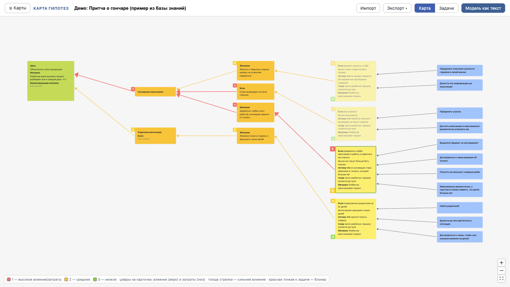
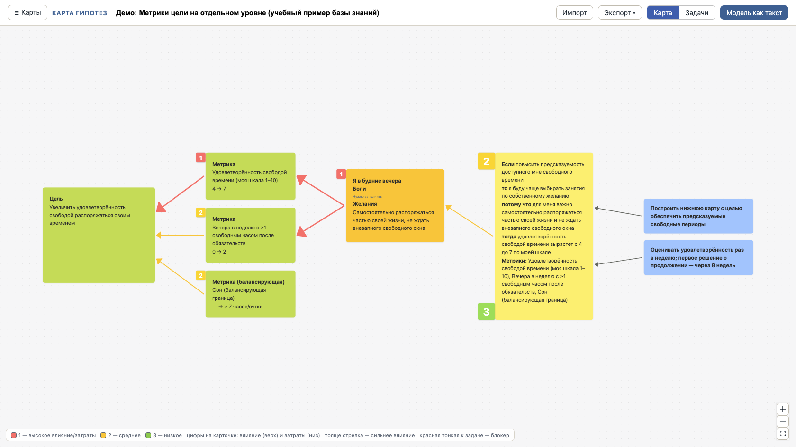
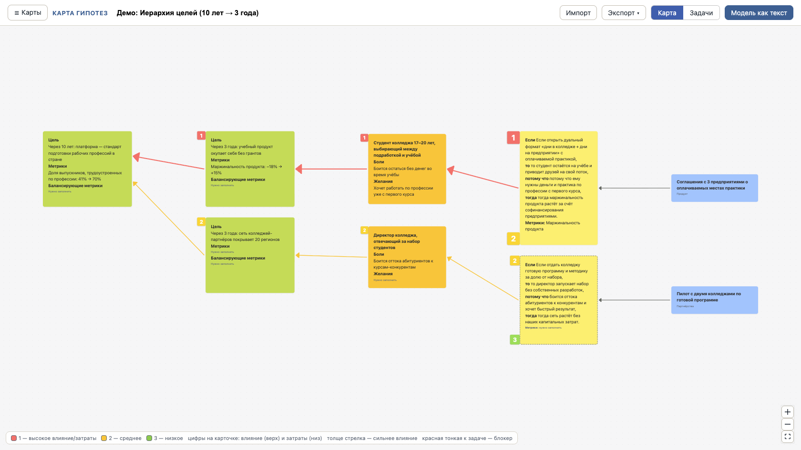
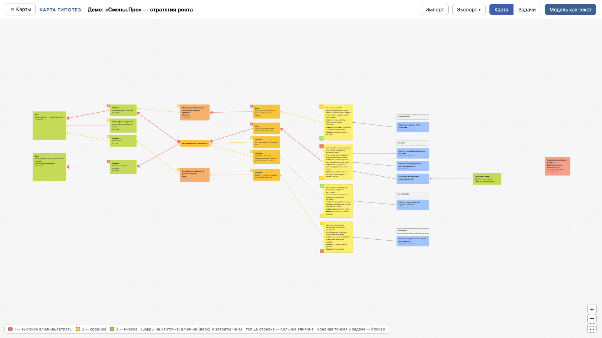
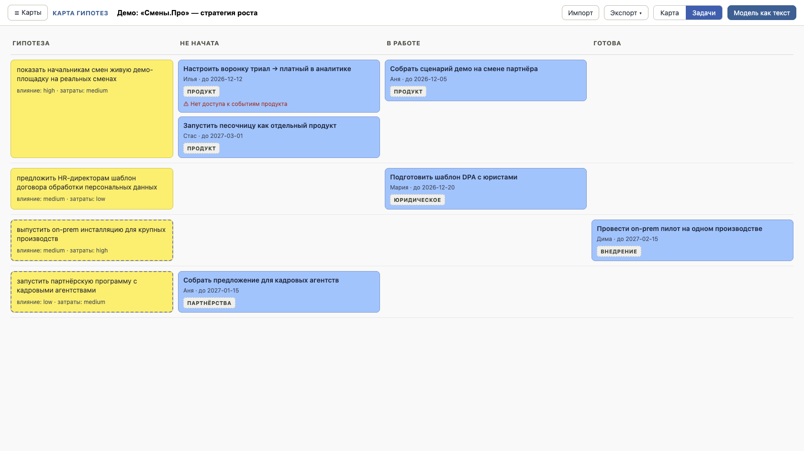
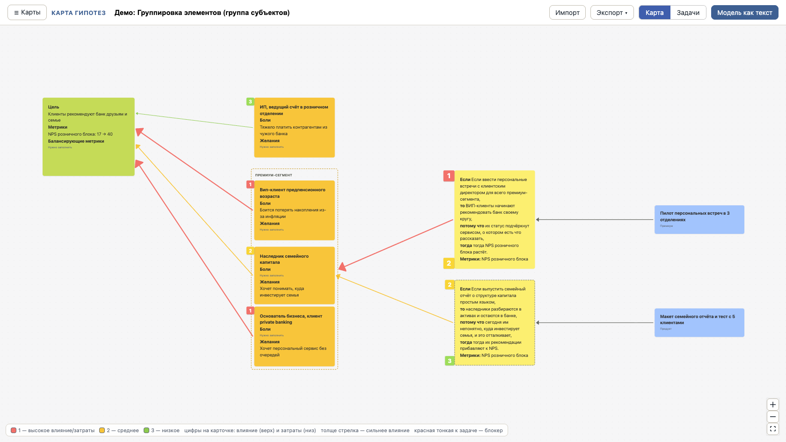
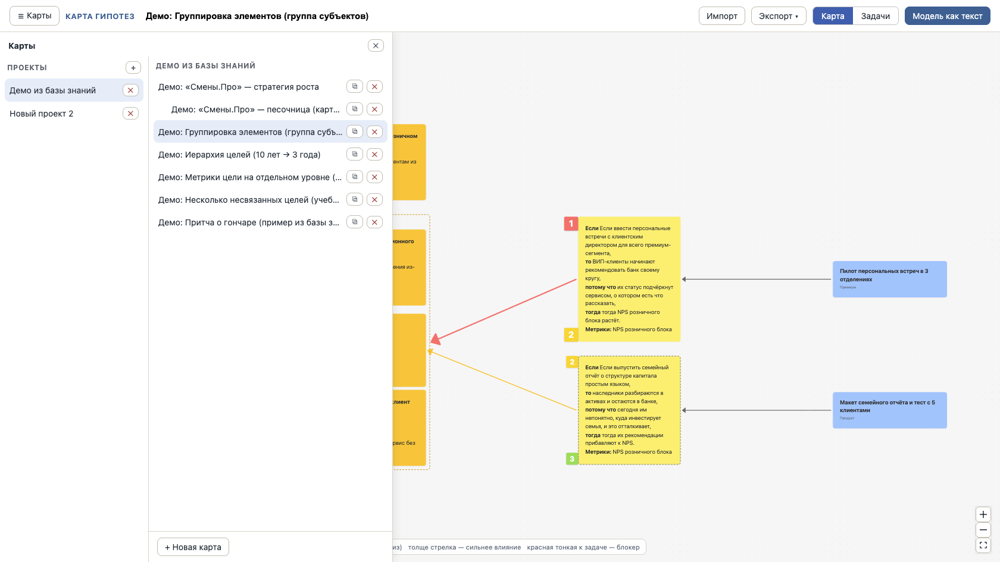

# Карта гипотез — веб-приложение

Полноценное локальное веб-приложение для работы с картой гипотез по стандарту 1.2
методологии Александра Бындю ([картагипотез.рф](https://картагипотез.рф),
[Byndyusoft/hypothesismapping](https://github.com/Byndyusoft/hypothesismapping)):
строго горизонтальная карточная доска, данные — в браузере, правки — через LLM
или руками в тексте модели. Без сервера, без аккаунтов, без CDN в рантайме.

## Быстрый старт

```bash
git clone https://github.com/nkhitrov/hypothesis-ui.git
cd hypothesis-ui
npm install
npm run dev        # открыть http://localhost:5173 — покажет демо-карты
```

Прод-сборка и самостоятельный хостинг — см. [«Запуск»](#запуск) и [«Хостинг»](#хостинг).


## Возможности

- **Строго горизонтальная доска** по стандарту: колонки слева направо
  цель → метрика → субъект → боль/желание → гипотеза → задача → блокер;
  колонка выделяется на каждый тип сущности — пустые колонки скрыты,
  отступы между всеми соседними колонками равные; стрелки идут только
  справа налево, плавными плоскими кривыми входят строго
  в правую грань карточки; толщина и цвет — по приоритету источника
  (высокий — толстая красная, средний — жёлтая, низкий — тонкая зелёная).
- **Все топологии каталога [topology.md](docs/knowledge-base/hypothesismapping/topology.md)**:
  классическая, многоцелевая, метрики на отдельном уровне, мотивация на отдельном
  уровне, иерархия целей («цель на 10 лет → цель на 3 года»), многоуровневые карты
  (`childMapId`, без запрещённой стандартом стрелки задача→цель), разбивка задач по
  направлениям, доска задач (портфель проектов), группировка элементов, негативные
  субъекты (отдельный цвет) — см. [скриншоты](#скриншоты).
- **Проекты**: карты сгруппированы в проекты, панель показывает проекты и карты
  одновременно (две колонки); выбранный проект, карта и область просмотра запоминаются.
- **Доска задач**: второй вид той же карты — статусы исполнения (не начата / в работе /
  готова) в сетке гипотеза × статус; задачи остаются привязаны к гипотезам по строкам.
- **Канонические цвета и цифры**: цель/метрика `#cadf58`, субъект/мотивация `#ffc831`,
  негативный субъект `#ffb373`, гипотеза `#ffef73`, задача `#a6cdff`, блокер `#FFA391`;
  приоритет — цифра 1–3 в квадратике у левого края карточки («относительно соседа слева»).
- **Хранение в браузере** (localStorage): несколько карт, автосохранение, данные переживают
  перезагрузку. При недоступном хранилище — баннер-предупреждение, работа продолжается.
- **Импорт/экспорт** JSON и YAML: файлом или буфером обмена (меню «Экспорт ▾» в топбаре),
  картой или целым проектом; валидация при импорте с человекочитаемым списком ошибок.
- **«Модель как текст»**: панель YAML/JSON-редактирования модели с «Применить» и «Откатить» —
  мост для правок через LLM без визуального редактора.
- **Жёсткие валидации топологии**: уникальность id, битые и типически недопустимые ссылки,
  запрет связи задача→цель, формат гипотезы «Если—то—потому что—тогда», запрет обхода
  вынесенного уровня (метрики/мотивации/под-цели). **Невалидная карта не рендерится вовсе** —
  вместо доски полноэкранный список проблем с кнопкой «Исправить в текстовом редакторе».

## Скриншоты

**Классическая доска** — «Притча о гончаре» из базы знаний: мотивация вынесена на отдельный
уровень, стрелки по силе влияния входят в правую грань карточек:



**Метрики цели на отдельном уровне** — количественные метрики карточками справа от цели:
субъекты влияют на метрики, метрики — на цель:



**Иерархия целей** — цель-связка: корень («10 лет») в крайней левой колонке, под-цели
(«3 года») правее со стрелками в родителя, стратегия строится от под-целей:



**Многоцелевая карта и разбивка задач по направлениям** — «Смены.Про»: нейтральные плашки
направлений над блоками задач (цвет задач не меняется), негативный субъект, блокер:



**Доска задач (портфель проектов)** — второй вид той же карты: статусы исполнения в сетке
гипотеза × статус, стрелок нет — задачи привязаны к гипотезам по строкам, блокеры
подсвечены красным:



**Группировка элементов** — рамка-группа из трёх субъектов: одна стрелка входит в рамку,
связь с конкретным субъектом внутри группы сохраняется:



**Проекты и карты** — панель двухколоночная: слева все проекты, справа карты выбранного
проекта; полные названия — подсказкой при наведении:



## Запуск

```bash
npm install
npm run dev        # дев-сервер
npm run build      # прод-сборка в dist/
npm run preview    # локальный просмотр собранной статики
```

## Хостинг

`npm run build` даёт полностью автономную статику в `dist/` (все зависимости в бандле,
сети в рантайме не нужно). Положите `dist/` на любой статический хостинг:
GitHub Pages, Netlify, Cloudflare Pages, nginx — или откройте локально.

## База знаний и скилл для LLM

В `docs/knowledge-base/` вендорена база знаний методологии (AGPL-3.0, см. NOTICE.md):
стандарт 1.2, топологии, примеры, а также готовый **скилл для LLM**
(`sociotech-ai-skills/hypothesis-mapping/SKILL.md`). Правила работы агентов с этим
репозиторием — в `AGENTS.md`: при любой правке карт следовать скиллу и стандарту.

## Цикл правок через LLM

1. В приложении: меню **«Экспорт ▾»** → «Скачать карту — YAML» (файл)
   или «Скопировать YAML карты в буфер».
2. Отдайте файл/текст модели своей LLM вместе со скиллом из `docs/knowledge-base`:
   «добавь гипотезу…», «смени цель…», «вынеси боли субъекта на отдельный уровень…».
3. Верните изменённый текст: **Импорт** (файл/drag&drop) → «Заменить текущую»/«Создать новую»,
   либо вставьте прямо в панель **«Модель как текст»** → «Применить».
4. Валидатор проверит не только ссылки, но и допустимость связей по стандарту 1.2 —
   нелегальную карту (например, задача→цель) невозможно применить, импортировать или отрисовать.

## Спецификация и прогресс (OpenSpec)

Проект ведётся по спекам [OpenSpec](https://github.com/Fission-AI/OpenSpec):

- `openspec/changes/add-web-app/` — текущее изменение: `proposal.md` (зачем),
  `design.md` (как), `specs/` (требования с сценариями), `tasks.md` (прогресс задач).
- `openspec/config.yaml` — контекст проекта и конвенции.
- CLI: `openspec list`, `openspec validate --all`, после приёмки — `openspec archive add-web-app`.

## Структура

```
├── AGENTS.md                  — правила для LLM-агентов (скилл + стандарт)
├── docs/knowledge-base/       — база знаний методологии и скилл hypothesis-mapping
├── docs/screenshots/          — скриншоты для этого README
└── src/
    ├── types.ts               — схема модели (цель/метрика/субъект/мотивация/гипотеза/задача/блокер/группа)
    ├── model/
    │   ├── validate.ts        — правила целостности и топологии стандарта 1.2
    │   ├── storage.ts         — localStorage: проекты + карты, автосохранение, пересев демо
    │   ├── io.ts              — импорт/экспорт JSON/YAML (карта и проект)
    │   ├── layout.ts          — полосная колоночная раскладка с итеративной сходимостью
    │   └── seed.ts            — 7 демо-карт из базы знаний
    └── components/            — MapView, CardView, FlowEdge, TasksBoardView,
                                 InvalidMapScreen, Sidebar, TextEditor, ImportDialog
```

## Демо-карты

- **«Притча о гончаре»** — дословный пример из базы знаний (strategyascode.md):
  классическая топология + мотивация на отдельном уровне (мотивация вынесена из текстов
  «потому что» самих гипотез).
- **«Смены.Про» — стратегия роста** — витрина топологий: многоцелевая карта, метрики
  и мотивация на отдельных уровнях, негативные субъекты, блокер, разбивка задач
  по направлениям, статусы исполнения (для доски задач).
- **«Смены.Про» — песочница (карта уровнем ниже)** — многоуровневая карта: раскрытие
  масштабной задачи отдельной дочерней картой (`childMapId`).
- **«Несколько несвязанных целей»** — учебные примеры скилла (examples.md №4–№6), дословно:
  субъектный контур (текучесть) и два бессубъектных контура (дата-центр, автоматизация
  заказов) — три независимые ветки на одной карте.
- **«Метрики цели на отдельном уровне»** — учебный пример личной стратегии из базы знаний
  (metricdesign.md): субъективная шкала, объективная метрика и балансирующая граница
  вынесены карточками справа от цели.
- **«Иерархия целей (10 лет → 3 года)»** — цель-связка: под-цели колонками правее
  родителя, стратегия строится от под-целей.
- **«Группировка элементов (группа субъектов)»** — по схеме topology.md: гипотеза
  воздействует на группу субъектов одной стрелкой, вторая — на конкретного субъекта.

## История

Проект начинался как python-пайплайн «YAML → Mermaid» (см. ранние коммиты), но
Mermaid-диаграммы не дают карточного вида, а у специализированных облачных сервисов
нет импорта. Приложение — собственная реализация канонического вида по стандарту 1.2,
локальная и самодостаточная.

## Лицензия

- Код проекта — [MIT](LICENSE), © 2026 nkhitrov.
- Вендоренная база знаний в `docs/knowledge-base/` — из репозиториев
  [Byndyusoft/hypothesismapping](https://github.com/Byndyusoft/hypothesismapping) и
  [Byndyusoft/sociotech-ai-skills](https://github.com/Byndyusoft/sociotech-ai-skills),
  лицензия AGPL-3.0 (см. `LICENSE` в соответствующих подпапках и `NOTICE.md`).
  При распространении сохраняйте указание авторства и лицензию этих материалов.
