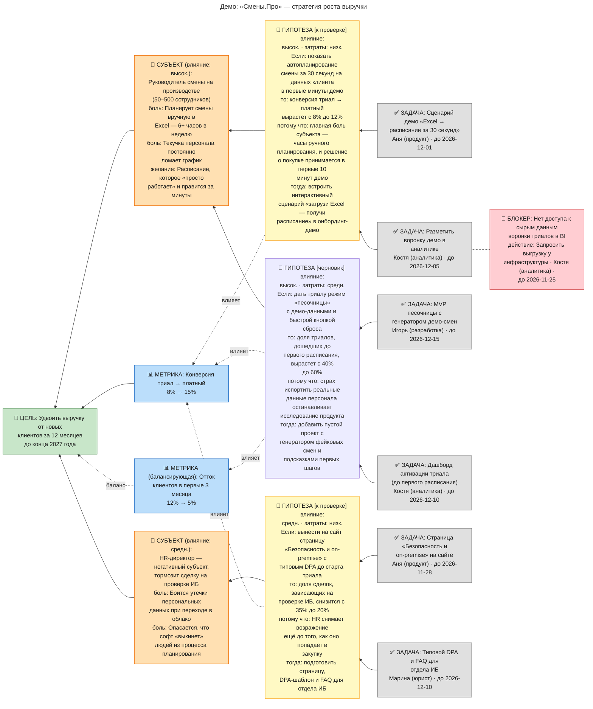

# Демо: «Смены.Про» — стратегия роста выручки

> Горизонт: до конца 2027 года · версия модели: 1 · обновлено: 2026-11-15
> Файл сгенерирован автоматически из `map.yaml` — правьте модель, а не эту диаграмму.

## Легенда

| Карточка | Тип |
|---|---|
| 🎯 | цель |
| 📊 | метрика |
| 👤 | субъект |
| 🧪 | гипотеза |
| ✅ | задача |
| 🚧 | блокер |

Статусы гипотез: жирная зелёная рамка — подтверждена, пунктирная рамка — черновик,
полупрозрачная — опровергнута. Пунктирные стрелки — влияние на метрику и балансирующие метрики.
